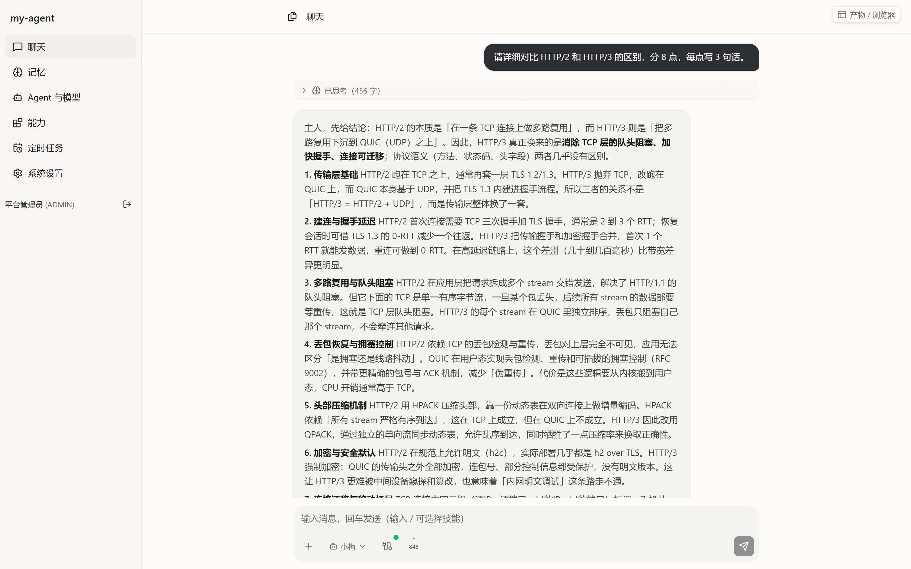
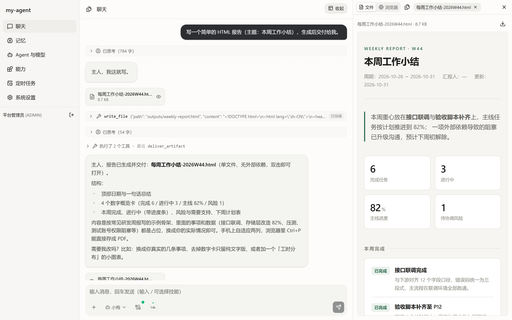
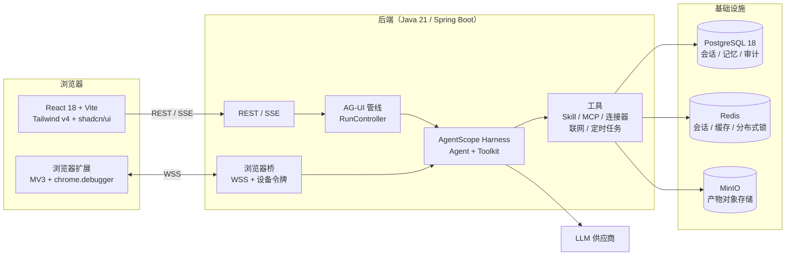

# my-agent

**一个可私有部署的 Agent 平台**：把大模型、Agent、Skill、MCP、连接器、IM 渠道、定时任务和长期记忆收在一处，用 Web 界面配置，用 AG-UI 协议流式对话。

[](#)
[](#)
[](#)
[](#)
[](#)
[](#)
[](#license)

> The README is written in Chinese (the project's primary language). See [English summary](#english-summary) at the bottom.

---

## 演示



<sub>流式对话：思考过程（结束后自动折叠）、Markdown 正文、输入框旁的上下文用量圆环</sub>



<sub>产物交付：工具调用过程可见，交付的文件挂在当轮气泡下方，右侧用沙箱 iframe 预览（HTML 报告）</sub>

---

## 特性

### 对话与交互（AG-UI）

- **流式对话**：正文逐字流式、思考块（流式中展开、结束自动折叠）、工具调用卡、工具调用分组
- **交互卡片**：选择卡（`ask_user_choice`）、映射卡（`propose_mapping`）、审批卡（HITL 中断），弹出即可点
- **子 Agent**：`subagent` 的思考/工具/正文按**到达顺序**呈现，刷新后仍可还原
- **上下文可控**：圆环显示上下文用量（token 数），支持一键压缩 / 清空
- **刷新接续**：页面刷新不会丢正在跑的这一轮，运行中的思考/工具/正文按快照还原
- **历史回放**：`agui_meta.replay` 记录每轮步骤，打开历史会话看到的内容与当时一致

### 能力配置

- **模型**：多家供应商（OpenAI 兼容 / DashScope / Anthropic），支持重试、上下文窗口与压缩阈值
- **Agent**：系统提示、温度、最大迭代、权限模式、技能/MCP 绑定、用户分配、配额
- **Skill**：标准 `SKILL.md` 结构的技能；支持**从 GitHub/GitLab 仓库一键导入**（预览 → 勾选 → 安装），带资源文件与安全扫描
- **MCP**：MCP Server 注册、工具同步与缓存
- **连接器**：邮件（收/搜/附件/发信/回复/新邮件通知）、Notion（搜索/读页/查库/新建/修改）、钉钉文档（知识库/搜索/读正文/新建/追加/删除）
- **联网**：内置 [Agent Reach](docs/agent-reach-集成方案.md) 作为 Agent 访问互联网的**唯一出口**（搜索/读网页/GitHub/V2EX/B站/YouTube），带 SSRF 护栏
- **浏览器**：本机浏览器扩展（Manifest V3）—— 在用户自己的真实标签页里操作，复用登录态，不传 Cookie、不持续传画面

### 平台

- **IM 渠道**：钉钉机器人（入站回灌 + 出站推送 + 长文本分片 + 图片/文件）
- **定时任务**：分布式抢占（多实例不重复执行），支持 cron / 每日 / 每周，可选推送到 IM
- **长期记忆**：`MEMORY.md` + 记忆台账**存数据库**，跨会话持久
- **审计与配额**：按用户/模型维度的 token 用量、按 Agent 的日/月额度
- **安全**：登录滑动验证码（服务端判定 + 行为分析 + 限流）、密码 RSA-OAEP 密文传输、JWT、连接器按用户隔离

---

## 架构



**关键设计取舍**

- Agent 侧只走 **AgentScope 官方能力**（工具、HITL、中断、压缩、Skill、MCP、AG-UI），不自研运行时
- 前后端通过 **AG-UI 事件流**通信，前端用 reducer 把事件折叠成消息树；同一套 reducer 也用于历史回放
- 产物是"按 run 归属"的：`artifact.run_id == 消息.run_id` 才挂在对应气泡下面
- 服务端**只跑运行时镜像**：编译与产物下载在本地完成（见[部署](#部署)）

---

## 快速开始

### 方式一：Docker Compose（推荐）

```bash
git clone https://github.com/WinterChenS/my-agent.git
cd my-agent

cp .env.example .env
# 至少修改：DB_* / REDIS_* / MINIO_* / JWT_SECRET / AGENT_CRYPTO_KEY
vim .env

docker compose up -d --build
```

- 前端：<http://localhost:18080>
- 后端：`127.0.0.1:18081`（只对本机开放，外部经 nginx 反代）

> 数据库迁移用 Flyway，启动时自动执行；首次启动会创建管理员账号（见 `.env` 中的初始化配置）。

### 方式二：本地开发

**环境要求**

| 组件 | 版本 |
|---|---|
| JDK | 21+ |
| Maven | 3.9+ |
| Node.js | **≥ 20.10**（推荐 22/24）；项目提供 `.nvmrc` |
| PostgreSQL | 16+（开发用 18） |
| Redis | 7+ |
| MinIO | 可选（不配置则产物存数据库） |

**后端**

```bash
cd backend/agent-server
export JAVA_HOME=/path/to/jdk-21
mvn spring-boot:run          # 默认 8080，读取仓库根目录 .env
```

**前端**

```bash
cd frontend
npm ci
npm run dev                  # 5173，/api 与 /agui 代理到 8080
```

**自检**

```bash
cd backend/agent-server && mvn verify   # 后端单测 + 集成测试
cd frontend && npm test && npm run lint && npm run build
bash scripts/check-node.sh              # 检查 node 版本与所需 flag
```

---

## 配置

所有配置通过环境变量注入（仓库根 `.env` + `application.yml` 的 `${VAR:default}`）。**`.env` 已在 `.gitignore` 中，不要提交。**

### 必填

| 变量 | 说明 |
|---|---|
| `DB_URL` / `DB_USERNAME` / `DB_PASSWORD` | PostgreSQL 连接 |
| `REDIS_HOST` / `REDIS_PASSWORD` | Redis 连接 |
| `JWT_SECRET` | JWT 签名密钥（≥32 字符） |
| `AGENT_CRYPTO_KEY` | 连接器凭据的对称加密密钥（≥32 字符） |

### 常用可选

| 变量 | 默认 | 说明 |
|---|---|---|
| `MINIO_ENDPOINT` / `MINIO_ACCESS_KEY` / `MINIO_SECRET_KEY` / `MINIO_BUCKET` | — | 不配置则产物落数据库 |
| `MYAGENT_WORKSPACE` | `./.myagent-workspace` | Agent 工作区（含用户 venv、技能缓存、产物） |
| `MYAGENT_REACH_ENABLED` | `true` | 联网出口（Agent Reach） |
| `MYAGENT_BROWSER_MODE` | `local-extension` | `local-extension` / `remote` / `disabled` |
| `MYAGENT_PUBLIC_BASE_URL` | — | 平台对外地址（用于扩展打包、下载链接） |
| `MYAGENT_CAPTCHA_ENABLED` | `true` | 登录滑动验证码 |
| `MYAGENT_ALLOW_PLAINTEXT_PASSWORD` | `false` | 是否允许明文密码登录（**仅本地调试**） |
| `SKILL_IMPORT_MAX_RESOURCES` | `600` | 单个技能的资源文件上限 |
| `SKILL_IMPORT_MAX_FILE_KB` | `8192` | 单个资源文件大小上限 |

完整清单见 `backend/agent-server/src/main/resources/application.yml` 与 `deploy/.env.example`。

---

## 部署

设计约束：**编译与二进制下载都在本地完成，服务器只跑运行时镜像**（避免在服务器上拉 Maven Central / npm）。

```bash
export JAVA_HOME=/path/to/jdk-21
./scripts/build-artifacts.sh                 # 后端 jar + 前端 dist + Chrome + Node 运行时

MA_SSH_HOST=your-host MA_SSH_USER=you MA_SSH_PASSWORD=... \
python scripts/deploy-docker.py              # 上传并 docker compose up -d --build
```

- `scripts/build-artifacts.sh` 会下载 `chrome-headless-shell`（远程浏览器模式用）与 Node.js 运行时
  （技能脚本用）到 `deploy/artifacts/`，这些**不入库**
- 部署成功后自动执行 `docker builder prune --keep-storage 2GB`，避免构建缓存把磁盘吃满
- nginx 侧需要为 `/api/browser/bridge/ws` 配置 WebSocket Upgrade（见 `deploy/nginx.conf`）

### 浏览器扩展（可选）

```bash
python scripts/build-extension.py --platform-url https://your-domain
```

产物在 `deploy/artifacts/my-agent-extension.zip`。安装：Chrome/Edge → `chrome://extensions` → 开发者模式 → 加载已解压的扩展程序。

---

## 项目结构

```
my-agent/
├── backend/agent-server/          # Spring Boot 后端
│   └── src/main/java/com/myagent/
│       ├── agui/                  # AG-UI 管线、Agent 工厂、工具（skill/mcp/连接器/联网/浏览器）
│       ├── auth/                  # 登录、验证码、RSA 密码加密、JWT
│       ├── chat/                  # 会话、消息、上下文用量
│       ├── connectorconfig/       # 连接器框架（凭据加密、按用户隔离）
│       ├── schedule/              # 定时任务（分布式抢占）
│       ├── artifact/              # 产物登记与存储
│       └── config/                # 安全、MyBatis、Web 配置
├── frontend/src/                  # React 前端
│   ├── components/chat/           # 气泡、思考块、工具卡、卡片、产物预览、浏览器面板
│   ├── lib/agui/                  # AG-UI 事件 reducer（实时 + 历史回放共用）
│   └── pages/                     # 聊天 / 记忆 / 管理台
├── browser-extension/             # MV3 浏览器扩展（原生 ES module，无需构建）
├── deploy/                        # Dockerfile、nginx、构建产物目录
├── scripts/                       # 构建、部署、导入与验证脚本
├── docs/                          # 技术方案、接入调研、实施说明
└── skills/                        # 内置技能（agui-interaction 等）
```

---

## 文档

| 文档 | 内容 |
|---|---|
| [`docs/技术方案.md`](docs/技术方案.md) | 架构、依赖版本、表设计、API 契约、卡片契约、设计门禁 |
| [`docs/连接器方案.md`](docs/连接器方案.md) | 连接器框架与邮件/Notion/钉钉的接入取舍与安全护栏 |
| [`docs/agent-reach-集成方案.md`](docs/agent-reach-集成方案.md) | 把 Agent Reach 作为唯一联网出口的设计与 SSRF 防护 |
| [`docs/登录滑动验证.md`](docs/登录滑动验证.md) | 验证码服务端判定、行为分析、限流与无障碍替代题 |
| [`docs/本机浏览器扩展-实施说明.md`](docs/本机浏览器扩展-实施说明.md) | 浏览器扩展、WSS 设备通道、控制权状态机 |
| [`docs/浏览器Agent-可行性调研.md`](docs/浏览器Agent-可行性调研.md) | 云端浏览器 vs 本机扩展的实测数据与取舍 |
| [`docs/dingtalk-doc-接入调研.md`](docs/dingtalk-doc-接入调研.md) | 钉钉文档 API 的权限模型与踩坑记录 |

---

## 安全说明

- **`.env` 不入库**：仓库只提供 `.env.example`，其中的密钥都是占位符，请务必替换
- **密码不明文传输**：登录走 RSA-OAEP(SHA-256)（公钥由后端下发，私钥只在内存）；明文登录默认关闭
- **验证码在服务端判定**：答案只存数据库，前端拿不到；带原子抢占、限流冷却与行为分析
- **连接器按用户隔离**：凭据加密存储，工具调用时按当前用户解析，不把凭据烘进工具实例
- **产物预览是沙箱 iframe**：`sandbox="allow-scripts"` 且不给 `allow-same-origin`，读不到本站 token/存储
- **联网有护栏**：Agent Reach 的 URL 策略会拒绝内网、本机、云元数据地址与非标准端口
- **浏览器扩展最小权限**：单标签页授权、可随时暂停/撤销、不申请 cookies 权限

发现安全问题请**不要开公开 issue**，请通过仓库主页的联系方式私下报告。

---

## 已知限制

- 单后端实例假设：WebSocket 设备通道与"正在跑的 run"登记在进程内存，多实例需要额外路由
- 产物预览只加载**单个文件**：多文件 HTML（如某些 PPT deck）依赖相对资源，预览侧会尽力按文件名内联，但仍建议导出单文件自包含版本
- 钉钉文档的"我的文档"既有文档无法通过 API 读取正文（平台限制）
- 浏览器扩展仅支持 Chrome/Edge 桌面版；未上架商店时需开发者模式加载

---

## 贡献

1. 开 issue 说明要解决的问题（避免重复劳动）
2. Fork → 从 `master` 切功能分支
3. 提交前跑：`mvn verify`、`npm test`、`npm run lint`、`npm run build`
4. PR 描述里写清"改了什么 / 为什么 / 怎么验证"

代码风格：后端遵循项目内既有注释习惯（**解释为什么**，而不是复述代码）；前端组件保持"一个文件一件事"。

---

## License

[MIT](LICENSE)

---

## English summary

`my-agent` is a self-hostable agent platform: Spring Boot 3 + AgentScope (Java) on the backend, React 18 + Vite on the frontend, PostgreSQL / Redis / MinIO for state storage.

Highlights: AG-UI streaming chat with thinking blocks, tool cards, interactive choice/approval cards and sub-agent traces; skill import from GitHub/GitLab; connectors for email, Notion and DingTalk Docs; a single guarded internet egress (Agent Reach); distributed scheduled tasks; database-backed long-term memory; and a Manifest V3 browser extension that drives the user's own logged-in tabs over a device-token WSS bridge.

Everything runs with Docker Compose; all secrets are provided via environment variables and are **not** committed to the repository.
