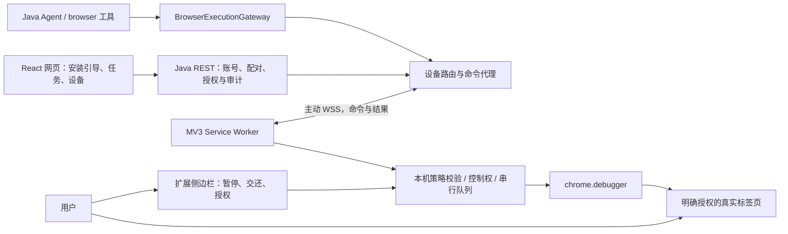

# 本机浏览器扩展技术方案：登录态复用、安装引导与人工接管

日期：2026-10-31  
适用仓库：`D:\project\my-agent`  
状态：技术设计，供评审与后续实施；本文不代表扩展已实现、上架或完成站点验证。

## 1. 决策与适用范围

采用“现有 B/S 平台 + Manifest V3 浏览器扩展”。React 网页、Java Agent、账号与审计继续部署在服务端；网页操作在用户本机已登录的 Chrome/Edge 标签页中执行。扩展主动通过 WSS 连接平台，不要求用户安装本地 Node/Python 服务，不开放本地远程调试端口。

用户已明确：可以安装扩展，优先稳定、清晰和服务器轻量；要求提供安装引导。以下默认值为本方案建议，尚未通过实际性能测试：首期桌面 Chrome/Edge、普通模式、单设备单任务串行控制、单任务一次授权一个标签页。生产域名、商店扩展 ID 和发布者账号在发布前配置，本文不虚构这些值。

目标：

- 复用目标站点已有登录态，避免导出和上传 Cookie。
- 用户观看真实网页，消除持续 JPEG 图传造成的模糊与服务端编码负担。
- 人工暂停在本机生效，避免 Agent 与用户同时操作。
- 网页提供完整安装、绑定、授权、升级和故障引导。
- 保留现有 `browser_*` 工具名，通过执行器接口迁移，减少 Agent 配置改动。

首期不覆盖：无人值守且用户电脑关机后的执行、手机浏览器、隐身模式、浏览器内部页、任意本地文件访问、验证码破解、原生文件选择框自动操作、跨配置读取账号、持续视频流、任意远程 JavaScript 执行。

## 2. 登录态复用的准确含义

扩展操作用户授权的现有标签页，目标网页继续使用同一浏览器配置中的 Cookie、站点 localStorage、IndexedDB 等正常完成请求。HttpOnly Cookie 不需要被扩展读取，更不需要传给 Java 后端。

例如：用户在 Chrome 的“工作”配置中登录某站，在同一配置安装扩展并授权该站标签页，即可继续使用该登录状态。如果站点要求二次验证，仍由用户在真实网页完成。站点登录过期不会被扩展“修复”。

边界：

| 场景 | 行为 |
|---|---|
| 同一配置、同一现有标签页 | 复用该页当前会话，推荐路径 |
| 同一配置、新建同站标签页 | 通常共享站点 Cookie；sessionStorage 等标签页级状态未必共享 |
| Chrome 切换到 Edge | 不共享；需在 Edge 自行登录并安装扩展 |
| 同一浏览器不同 profile | 不共享；各自安装、绑定与授权 |
| 隐身窗口 | 首期拒绝接入，避免会话与权限语义混乱 |
| 用户退出站点或 Cookie 过期 | 返回“需要登录”，暂停任务，用户自行登录 |
| 用户更换站点账号 | 原授权暂停，确认新账号后重新获取控制权 |

复用登录环境不能保证不触发风控。网站仍可结合操作频率、账号状态、网络、浏览器特征和行为判定风险。不得承诺“100% 不风控”。账号自动识别只能作为提示，不应把网页上的任意用户名文本当作可信身份；涉及账号归属的动作由用户确认。

## 3. 当前实现与迁移动因

核对基线提交：`c5677fa`、`8b4aa2e`、`3eb30a9`。

| 现有位置 | 现状 | 新方案处理 |
|---|---|---|
| `BrowserSession.java` | 后端启动 headless-shell，直接维护 CDP | 本机执行不再经过此类 |
| `BrowserProperties.java` / `application.yml` | JPEG 质量 60，默认 1280×800 | 本机观看无需 JPEG 流 |
| `BrowserSession.startScreencast()` | 上限使用初始配置，动态视口未同步图像上限 | 停用本机模式的 screencast |
| `BrowserPreview.tsx` | canvas 绘制，没有高分屏 DPR 适配 | 改为连接、标签页与任务状态面板 |
| `CdpClient.java` | 多来源发送缺少统一队列；fire 不观察发送 future | 本机使用 chrome.debugger；所有动作统一调度 |
| `BrowserController.frames()` | CDP 回调中直接执行 SSE send | 不再转发实时帧；状态与截图独立通道 |
| 人工接管 | 布尔值 + 60 秒自动交还，无法阻止已排队操作 | 本机控制权状态机 + 版本号 + 队列失效 |
| 启动与网络 | `--no-sandbox`，浏览器与业务后端同容器 | 用户浏览器正常沙箱；旧远程模式独立治理 |

以上为源码审查结果。生产人工操作报错的具体归因仍需错误堆栈验证；并发发送、慢客户端阻塞属于需要验证的候选，不能当作已复现结论。旧文档所述历史服务器内存/CPU 数据不是本次新测试数据。

## 4. 总体架构与责任划分



后端负责“谁能请求什么”；扩展再次负责“这个设备、标签页和当前状态是否允许执行”。网页内容、模型输出、服务端命令都不能绕过扩展的本地操作清单与授权校验。

数据默认：发送有限的结构化页面快照、命令、结果、状态事件；不持续发送画面。截图按需、显式授权上传。原生网页显示不产生平台图像缩放问题，但截图显示仍应保持比例与足够分辨率。

本机不会降低目标网页自身的内存消耗，只是把浏览器运行成本从平台转移至用户设备。服务端不再因每个在线用户启动一个 Chromium 而线性增加浏览器进程。

## 5. 安装引导与首次使用

### 5.1 入口

- 网页右侧“浏览器”面板，在本机模式下显示连接与授权状态。
- 设置页新增“浏览器连接”入口：设备、安装、升级、撤销、故障诊断。
- Agent 首次需要浏览器时返回结构化 `EXTENSION_REQUIRED`，前端展示安装卡，暂停依赖操作；不引导模型反复重试工具。

文案示例：“连接你的浏览器。安装扩展后，Agent 可以在你授权的网页中操作，继续使用该浏览器已有的登录状态。你可以随时暂停。”

### 5.2 引导状态机

| 状态 | 用户看到的内容 | 主操作 |
|---|---|---|
| `CHECKING` | 正在检查浏览器连接 | 等待，短时间后转可操作页面 |
| `NOT_DETECTED` | 尚未检测到扩展，可能未安装或被停用 | “安装 Chrome 扩展” / “安装 Edge 扩展” / “我已安装，重新检测” |
| `INSTALLED_UNPAIRED` | 已安装，尚未连接账号 | “连接当前账号” |
| `PAIRED_OFFLINE` | 已绑定，浏览器连接离线 | “打开扩展检查连接”及可展开诊断 |
| `UPDATE_REQUIRED` | 版本不兼容 | “查看更新方法” |
| `READY_NO_TAB` | 已连接，还没有授权网页 | “在扩展中选择网页” |
| `TAB_AUTHORIZED` | 显示设备、站点、控制状态 | “开始任务” / “撤销授权” |
| `HUMAN_CONTROL` | 你正在操作，Agent 已暂停 | “交还给 Agent” |
| `UNSUPPORTED` | 手机、非支持浏览器或受管理策略限制 | 说明支持范围，不反复提示安装 |

检测失败不能断言扩展不存在：可能是配置不匹配、禁用、受策略限制或外部消息未许可。安装状态与设备在线状态独立显示；其他电脑的在线设备不能被当作“当前浏览器已安装”。

### 5.3 正式安装路径

1. 网页根据浏览器能力与用户选择展示对应商店按钮；UA 识别仅作默认推荐，用户可切换。
2. 用户点击后，在新标签页打开真实商店详情页。链接由发布配置提供，限制为官方商店来源，不接收任意远程跳转地址。
3. 用户在商店点击安装并确认浏览器权限。网页不能静默安装，也不能代替用户接受权限。
4. 扩展 `runtime.onInstalled` 打开自身欢迎页，介绍权限用途，提供“连接平台”与“暂时跳过”。不在每次更新时重复打开。
5. 原平台页面保留安装前草稿与待恢复任务；恢复前必须重新确认任务上下文，不能安装后自动执行敏感动作。
6. 用户返回网页时，通过 `visibilitychange` 重新检测；页面可在引导期间短期轮询，60 秒后停止并保留“重新检测”，不无限轮询。
7. 扩展完成配对后，通过后端状态更新网页，自动进入标签页授权步骤。

未上架阶段：内部测试包提供版本、SHA-256、来源和“解压后加载”图文说明。该路径只面向内测；正式用户不以开启开发者模式作为默认安装方式。企业用户可采用管理员策略部署，另行配置。商店发布账号、审核周期、网络可达性都是上线依赖；不把本地 ZIP 下载当成“一键安装”。

Chrome 与 Edge 分别维护商店 ID、详情页链接及更新说明。无可用链接时显示“内测中”，不呈现失效安装按钮。

### 5.4 安装检测实现

官方部署通过 `externally_connectable.matches` 精确列出受信任平台域名。网页用 `chrome.runtime.sendMessage(已配置扩展ID, {type:'bridge.ping', nonce})` 检测；扩展只返回协议版本、扩展版本、功能能力、非秘密的随机 installId 与 nonce。installId 仅用于与当前用户设备列表比对，不是认证凭证，不对未信任网站暴露。不得通过此通道返回 token、页面内容或接受执行命令。

扩展同时核对 `sender.url` 的 origin 和协议，消息做 schema 校验、大小与频率限制。网页只能据此判断本浏览器扩展可通信；账号绑定状态由后端与当前安装实例共同核对。

浏览器不支持网页外部消息时，以扩展欢迎页和设备连接状态完成引导，显示“安装检测不可用”而非“未安装”。开发版独立配置 localhost 来源；生产版不包含通配任意网站的外部消息规则。

自部署：首期以一个官方生产域名为默认。自部署者可构建包含自己域名的独立扩展，或让用户在扩展设置中显式添加可信 HTTPS 平台地址、通过设备配对连接；后一方式不能依赖官方域名外部消息自动检测。自部署地址切换会撤销当前控制权并重新确认连接目标，不能由网页消息静默修改。

### 5.5 日常使用界面

主网页保留完整聊天；右侧显示当前设备、已授权站点、当前步骤和最近按需截图，提供“定位网页”“暂停”“撤销”。定位/激活标签页通过设备通道请求，仍要求当前账号有权控制该设备。

扩展侧边栏只做轻界面：连接身份、任务摘要、选页授权、暂停、交还、敏感确认、断开。不在首期复制整套聊天编辑器。用户直接在目标真实标签页完成扫码、登录、输入法、文件上传和验证码；无需将人工键盘事件通过 Java 后端转发。

不能把用户真实标签页任意嵌入平台 iframe 当作通用方案。平台内预览是辅助，真实操作页面在独立标签页或窗口；这是本方案明确的产品取舍。

## 6. 扩展模块与权限

建议新增独立 TypeScript/Vite 工程 `browser-extension/`，复用类型定义而不依赖前端运行时。首期优先 Chrome，Edge 必须跑同一套兼容性验收。

| 模块 | 职责 |
|---|---|
| `background/connection` | WSS 生命周期、鉴权、心跳、重连 |
| `background/pairing` | 设备配对、凭证刷新与撤销 |
| `background/policy` | 标签页、origin、操作、大小及期限检查 |
| `background/scheduler` | 每标签页串行调度、命令去重、控制权版本 |
| `background/debugger` | attach/detach、CDP 调用、目标与 frame 追踪 |
| `background/snapshot` | AX/DOM 摘要、元素引用、敏感过滤 |
| `content/interaction-observer` | 经授权页面的人工交互提示；不是唯一暂停机制 |
| `sidepanel/` | 授权、暂停、交还、确认与故障界面 |
| `onboarding/` | 安装欢迎页、连接平台与配对说明 |
| `shared/protocol` | 固定协议、错误码、schema、版本 |

建议基础权限：`storage`、`activeTab`、`scripting`、`sidePanel`、`debugger`、`alarms`。平台 REST 所需 host permission 只包含配置的平台 HTTPS 来源。访问目标站点的脚本注入使用用户手势授予的 activeTab；跨站失效后要求新的用户授权。确需持续站点脚本时才以 optional host permissions 单独请求。首期不请求 cookies、history、nativeMessaging、任意文件、全站持久访问或后台下载权限。

首期选页流程固定为：激活目标标签页 → 用户在该页点击扩展工具栏按钮，取得该页 activeTab → 在扩展界面确认站点与任务。网页或侧边栏中选中某个 tab 不等于已经取得它的 activeTab。侧边栏选择未授权页时，提示用户切到该页点击扩展；如以后支持直接授权任意页，应在用户手势内申请该 origin 的 optional host permission，不能偷换成全站权限。

`debugger` 本身是强权限，不能声称 activeTab 会在浏览器层面把所有 CDP 能力限制在当前站点。我们必须额外维护本地授权表，阻止越权 tab/origin，并在授权结束 detach。安装页要用中文解释浏览器调试提示的用途；用户终止调试即视为撤销控制。

所有执行逻辑随扩展打包。后端只能发送固定动作与数据参数，不发送远程模块、任意 CDP 方法名或可执行 JS。`Runtime.evaluate` 如需使用，只执行扩展自带、经过审阅的模板，参数严格作为数据编码；不接受模型提供的表达式。否则既扩大攻击面，也可能违反 MV3 远程托管代码政策。

## 7. 设备配对、账号与凭证

平台网页登录 JWT 只属于网页，不直接复制给扩展。扩展使用单独的设备身份，权限仅限浏览器连接，不能调用用户管理等业务 API。

采用带 PKCE 校验的设备授权流程：

1. 扩展在本地生成随机安装实例 ID 与 verifier（至少 256 bit），保存 verifier，发送其 S256 challenge 到选定平台的配对初始化接口。
2. 后端生成高熵 deviceCode、短 userCode、5 分钟有效期和固定 verification URI。数据库只保存 code 的安全摘要；接口限流。
3. 扩展打开固定平台配对页面，用户在网页登录后输入/确认 userCode。页面展示设备名、浏览器、申请时间与配对状态；用户明确批准。配对页面不接受任意 redirect URI，不把凭证放 URL。
4. 扩展按服务端间隔轮询状态；领取结果必须提供 deviceCode 与匹配 verifier。批准记录还须匹配安装实例，且只能领取一次。userCode 只用于人工批准，不能兑换凭证。
5. 后端签发 10 分钟设备 access token 和最长 30 天、可轮换的 refresh token，绑定 userId、deviceId、installId、scope 与 credentialVersion。
6. refresh token 单次轮换；重用旧 token 会冻结对应设备凭证并要求重新配对。数据库保存 refresh token 摘要，不记录明文。

扩展 access token 放 `chrome.storage.session`；refresh token 放 `chrome.storage.local` 并禁止 content script 访问（storage access level 设置为 trusted contexts）。这不是硬件加密保险箱，不能防御本机账号失陷；用户可从网页撤销设备。卸载重装按新安装实例重新配对，不默认恢复之前的授权。

账号停用、撤销设备、refresh 重用应主动断开 WSS；每次刷新、创建控制会话和签发命令均复查账号可用性。现有 `JwtAuthFilter` 的数据库回查不会自动保护已经建立的长连接，需独立补上检查与撤销广播；最长 30 秒状态巡检兜底。

网页退出账号时，撤销由该网页会话建立的控制会话；设备绑定可保留，但扩展不得因此继续旧任务。为使该语义成立，新增服务器认可的网页登录会话 sid：新网页 JWT 带 sid，后端保存其状态/到期时间，控制会话绑定 initiating_web_session_id；注销接口先撤销 sid 及其控制会话，再由前端清理本地登录态。鉴权、设备调度及续控制权都检查 sid 状态。历史无 sid 的 JWT 不允许创建本机控制会话，提示重新登录。不把“本地删除 token”或关闭页面等同服务器已经收到注销；这些情况由会话/控制租期到期兜底。其他设备不会被默默选为替代执行器。换平台账号必须撤销旧绑定并重新配对。

## 8. WSS 与 REST 接口

### 8.1 接口草案

以下为拟新增接口，不是当前已存在的能力：

| 方法与路径 | 身份 | 用途 |
|---|---|---|
| `GET /api/browser/extension/config` | 网页 JWT | 商店链接、协议与最低版本、支持范围 |
| `POST /api/auth/logout`（新增或扩展） | 带 sid 的网页 JWT | 撤销网页 sid 及其控制会话 |
| `POST /api/browser/pairings` | 限流的未配对扩展 | 创建配对挑战 |
| `POST /api/browser/pairings/approve` | 网页 JWT | 批准 userCode，仅归属本人 |
| `POST /api/browser/pairings/token` | deviceCode + verifier | 轮询/领取设备凭证 |
| `POST /api/browser/device-token/refresh` | refresh token | 轮换凭证 |
| `GET /api/browser/devices` | 网页 JWT | 本人设备与最后在线时间 |
| `DELETE /api/browser/devices/{id}` | 网页 JWT | 撤销本人设备与活跃会话 |
| `POST /api/browser/control-sessions` | 网页 JWT | 为 conversation + device 创建待授权会话 |
| `POST /api/browser/control-sessions/{id}/pause` | 网页 JWT | 请求暂停；收到本机确认前显示“正在暂停” |
| `DELETE /api/browser/control-sessions/{id}` | 网页 JWT | 撤销会话 |
| `GET /api/browser/control-sessions/{id}` | 网页 JWT | 查询连接、控制权、步骤状态 |
| `GET /api/browser/bridge/ws`（Upgrade） | 首帧设备鉴权 | 扩展主动长连接 |

扩展授权/交还/确认通过已鉴权 WSS 上报；后端不能伪装本机用户点击直接批准。所有资源查询按 token 的 userId 过滤，不信任 body 中的 userId。配对接口采用专门的限流与输入规则，不能简单放开整个 `/api/browser/**`。

### 8.2 长连接鉴权

浏览器 WebSocket 构造器不能任意设置 Authorization 头，不能直接照搬当前 Bearer REST 过滤器。推荐：TLS 握手后 5 秒内发送 `auth` 首帧携带短期设备 token；未认证连接仅允许 auth、小消息和短超时，绝不注册设备或接收执行命令。专用 handshake interceptor 校验 Origin、限流和容量；token 验证通过后建立 userId/deviceId 上下文。

不把 access/refresh token 放查询串、日志或子协议字符串。Origin 与商店 ID 是辅助检查，不能替代 token 鉴权。若部署容器不能返回可靠扩展 Origin，默认拒绝并通过兼容性测试调整明确规则，不开放任意来源。

### 8.3 可靠性

- 活跃连接每 20 秒心跳，60 秒无响应判离线；WebSocket 消息可维持 Chrome 116+ 的 MV3 worker 活跃，但不能假设进程永远不退出。
- access token 到期前通过 REST refresh 换取新 token，再发送 `auth.refresh` 帧。后端校验同 userId/deviceId、scope、credentialVersion 及账号状态后更新该连接的认证期限；到期未续签则暂停并关闭连接，不能用首次鉴权无限延长权限。刷新必须单飞，避免并发消费同一 refresh token。
- worker 休眠、浏览器重启、系统休眠、扩展更新均按重连处理，使用 alarms 辅助唤醒；不通过持续截图维持存活。
- 重连指数退避 1/2/4/8 秒，上限 30 秒并加抖动；鉴权拒绝停止重试并提示用户。
- 每次连接生成新 connectionEpoch；旧连接命令失效。设备只保留一个活跃主连接，抢占须可见，不能让两个连接同时执行。
- 控制权在断线时进入 `SUSPENDED`；重连不自动恢复写操作。未确认结果的命令标记 `OUTCOME_UNKNOWN`，尤其提交动作不能重放。
- 断线不是拔网线即刻可知：以 onclose/onerror 或心跳超限作为已检测失联。扩展最多保留一个在途原子动作，不预收长动作序列；后端发出的每条动作有效期建议不超过 15 秒，扩展启动前检查本机控制状态与心跳新鲜度。检测失联后清空待执行命令；检测前已发出的动作仍可能完成。
- 单命令正文建议上限 64 KiB；结构化快照建议上限 256 KiB/500 元素，正文 20,000 字符。大截图使用独立、已鉴权上传接口，默认单张上限 4 MiB，不挤占控制通道。
- 不实现 exactly-once 承诺。消息可能重传，动作采用 requestId 去重与结果缓存；崩溃窗口不能确定是否已产生外部效果时，必须人工核查。

## 9. 命令协议与元素定位

示例命令（字段供实现对齐）：

```json
{
  "protocolVersion": 1,
  "type": "command",
  "requestId": "req-random",
  "controlSessionId": "ctl-random",
  "connectionEpoch": 4,
  "leaseVersion": 9,
  "pageRevision": 12,
  "action": "click",
  "target": { "tabHandle": "tab-opaque", "elementRef": "el-42" },
  "expectedOrigin": "https://example.com",
  "args": {},
  "approvalId": null,
  "expiresAt": "2026-10-31T08:00:15Z"
}
```

这是示例时间，不是实际排程。扩展在执行前逐项验证协议、用户会话、连接代次、控制权版本、页面版本、tab 映射、当前 origin、动作清单、有效期与确认凭据。过期或状态不匹配直接拒绝，不自动“猜一个新元素”。

允许动作：`get_snapshot`、`click`、`type_text`、`press_key`、`scroll`、`navigate`、`capture_screenshot`、`wait_for`、`focus_tab`。不允许模型直接指定 CDP method、读取 Cookie、运行 shell、执行任意 JS 或抓取任意后台 URL。每个动作独立 schema 与文本/坐标/键值上限。

快照优先采用可访问性树与精简 DOM 信息，保留 role、可见文本、允许的输入信息和元素引用。以扩展本地保存的 elementRef → frame/document/backendNodeId 映射定位，优先元素定位，坐标只作截图对应版本内的兜底。

导航、document replacement、iframe 重建都会失效元素引用并递增 pageRevision；动态 DOM 变化时至少在每次执行前验证节点仍连接、可见、可交互与位置有效。不能仅凭 URL 相同认为旧坐标仍可用。iframe/OOPIF 需要跟踪对应 target/session 和执行上下文；跨 origin iframe 默认不可读/不可操作，单独授权后才纳入。closed shadow DOM 等不可可靠定位时返回限制，不静默点击近似元素。

返回结构包含 `requestId`、`status`、`errorCode`、`message`、`pageRevision`、`controlState`、耗时和有限结果；区分“命令已收到”“已开始执行”“已完成”。导航成功需要页面状态/目标元素等有界等待，不能再使用固定 sleep 当成页面就绪判断。

快照在扩展本地按 frame origin 过滤，不能先上传整棵树再让后端删减。整页截图还会拍到跨域 iframe 像素：首期检测到未授权跨域 iframe，或无法可靠确定 frame 来源/边界时拒绝截图，并提示先授权或使用结构化快照。不能以“没有读取 iframe DOM”推导“截图没有泄露其内容”。

主要错误码：`EXTENSION_REQUIRED`、`DEVICE_OFFLINE`、`VERSION_UNSUPPORTED`、`TAB_NOT_AUTHORIZED`、`ORIGIN_CHANGED`、`STALE_PAGE`、`ELEMENT_NOT_FOUND`、`HUMAN_CONTROL`、`APPROVAL_REQUIRED`、`DEBUGGER_DETACHED`、`COMMAND_EXPIRED`、`OUTCOME_UNKNOWN`、`LOGIN_REQUIRED`、`POLICY_BLOCKED`。

## 10. 人工接管与并发控制

### 10.1 本机状态为执行依据

```text
UNBOUND -> CONNECTED -> AWAITING_TAB_GRANT -> HUMAN_CONTROL
HUMAN_CONTROL --本机用户点击交还--> AGENT_CONTROL
AGENT_CONTROL --本机暂停/可信人工交互信号--> HUMAN_CONTROL
任意活跃状态 --断线/更新/worker恢复--> SUSPENDED
任意活跃状态 --撤销/账号停用/关闭标签页--> REVOKED
跨站导航 -> AWAITING_ORIGIN_GRANT（阻止新站内容读取和后续动作）
```

授权后默认先在人类控制状态展示任务，让用户点击“开始/交还”。不再用 60 秒无操作自动恢复写操作。后端镜像状态仅供调度和显示，扩展每个动作之前还要检查本机状态。

每个标签页只允许一条动作队列，首期同一设备仅一个活跃控制会话。每次暂停/撤销递增 leaseVersion，并取消未开始命令；所有旧版本命令拒绝执行。不能通过额外 conversation 抢占同一标签页。

### 10.2 暂停的准确保证

扩展侧边栏和工具栏的“暂停”直接在本机执行，无需等待网络。收到暂停事件后，禁止开始任何新步骤并清空未开始队列。在点击“开始下一个步骤”前再次校验 leaseVersion。

已经发送给浏览器的单个动作、已经提交给网站的 HTTP 请求无法保证撤回。点击按下/松开等短输入序列应有明确边界，并在中止时释放按键/鼠标状态，避免留下按住状态。产品文案不能承诺回滚已提交业务。

人工交互自动检测采用经过授权的 content script，监听 pointer/key/composition 等信号。单看 `event.isTrusted` 不能区分用户与 CDP 注入，因为自动输入也可能产生可信事件。需要扩展自己的注入阶段标识、时间窗与事件关联，检测不确定时保守暂停。首期以显式本机“暂停”为可靠路径，自动检测属于辅助能力，必须用并发人工输入场景验证，不能宣称已彻底解决。

用户打开 DevTools、点击停止调试、标签页关闭、浏览器丢弃/重载页面触发 debugger detach 或目标变化时，立即暂停和失效队列，提示原因；恢复必须重新确认，不无限自动 attach。

### 10.3 敏感动作

提交表单、发送消息、付款、删除、授权 OAuth 等改变外部状态的动作需确认。采用双层策略：Agent 标记风险；扩展根据可识别语义和执行类型补充检查，未知写动作保守要求确认。不能保证仅凭按钮文字完美识别风险。

批准记录绑定 controlSession、origin、pageRevision、具体动作和参数摘要、一次性 approvalId、短有效期；页面或参数变化后重新确认。确认在扩展侧边栏完成，避免仅靠后端伪造批准。复杂网站无法可靠识别业务提交边界时，停在最后一步，由用户在真实网页手工提交；验证码、密码与 MFA 也采用此方式。

## 11. 安全与隐私

| 风险 | 本方案要求 |
|---|---|
| 远程接管整台浏览器 | 单标签页授权、单会话、固定操作清单、本机随时撤销 |
| 页面提示注入 | 页面内容标记为不可信，不能授权新站点、扩大权限或批准写动作 |
| 凭证泄露 | 不申请 cookies 权限；不采集请求认证头、Cookie、站点存储全集 |
| 正文/截图含隐私 | 快照最小化、默认过滤密码/验证码/卡号等；截图默认关闭，单独授权、可遮罩 |
| 网站要求输入密码 | 用户直接输入，Agent 暂停读取；敏感输入不写入命令审计 |
| 元素引用越权 | 所有引用绑定 frame/document/revision/tab，会话结束即销毁 |
| 重定向或新标签页越权 | 跨 origin 清除读写授权；新标签页仅提示授权，不自动跟随读取 |
| 本机/内网访问 | 首期仅允许明确授权的公网 HTTPS origin，拒绝 file/chrome/edge/扩展页、localhost、IP/私网目标和非标准端口 |
| DNS 重绑定 | 扩展 URL 校验不能代替网络级隔离；不提供任意 fetch/代理能力，导航与跨站授权做本地校验。若要保证 DNS 层出网隔离，需企业网络策略或独立远程执行环境 |
| 后端失陷 | 扩展仍执行本地授权和动作白名单；但已授权站点内容与权限仍存在风险，不宣称服务端失陷后绝对安全 |
| 扩展被替换 | 官方商店签名与更新、固定发布者、构建产物摘要、最小权限、依赖锁定与审查 |
| 设备被他人使用 | 撤销入口、会话到期、显式开始；不把浏览器已登录视为无限期授权 |

快照默认不上传 input value；对普通表单值如确需读取，按字段能力明确开放。截图遮罩无法保证覆盖页面绘制的所有秘密，因此含密码/MFA 的人工登录阶段禁止采集，不以“我们会脱敏”作为无限截图的理由。上传到后端的数据也可能进入模型上下文，安装与授权页必须说明。

首期审计默认保存动作类型、origin、状态码、耗时和摘要，不保存输入正文、完整 URL 查询参数、token、配对 code。截图默认不持久化；如用户明确选择保存为产物，则复用现有产物权限和保留策略，并展示保存行为。命令结果缓存只存最小结果和状态，不能借去重缓存无限保存隐私。

## 12. 后端改造与持久化

### 12.1 执行器抽象

新增 `BrowserExecutionGateway`（拟名），提供 open/snapshot/click/type/scroll/wait/status/pause 等结构化方法。实现：`LocalExtensionExecutor`；现有服务端 Chromium 包装成可选 `RemoteBrowserExecutor`，首期默认关闭远程回退。

`BrowserTools` 仅负责参数、用户/会话上下文、调用 gateway 与格式化结果，不直接调用 `BrowserSessionRegistry`。保留既有工具名，但更新说明：“操作用户授权的本机标签页；离线与人工控制时暂停”。`browser_open` 不得绕过人工控制/跨站授权；首次打开未知网站只能提出本机授权请求。

设备选择存于 conversation 的浏览器上下文，不能“任意选最近在线设备”。打开已有受权标签页的 URL 仍需验证导航权限。`browser_scroll` 去掉固定 640/400 坐标，使用当前快照对应视口。

等待用户安装/授权/接管时，工具返回可恢复阻塞状态，不占用 HTTP 工作线程等待数分钟。具体对接现有 Agent 暂停/工具结果机制时，优先复用已有会话事件；如运行时不能恢复原工具调用，则结束本轮并保存待办摘要，用户确认继续后启动新一轮，不能虚构运行时支持。

### 12.2 存储

拟新增 PostgreSQL 表（字段名可按现有迁移规范调整）：

- `auth_web_session`：sid、user_id、status、expires_at、revoked_at，用于可撤销的网页登录会话与控制会话关联；其他业务 JWT 是否一起失效按统一认证实现落地，浏览器控制相关路径必须检查。

- `browser_device`：id、user_id、install_id、display_name、browser、extension_version、credential_version、status、created_at、last_seen_at、revoked_at。
- `browser_pairing`：device_code_hash、user_code_hash、pkce_challenge、install_id、expires_at、approved_by、approved_at、consumed_at、attempt_count。
- `browser_device_credential`：device_id、refresh_token_hash、token_family、rotation_version、expires_at、revoked_at；唯一约束阻止重复消费。
- `browser_control_session`：id、user_id、conversation_id、initiating_web_session_id、device_id、opaque_tab_handle、origin、state、lease_version、expires_at、ended_at。
- `browser_action_audit`：request_id、session_id、action、origin、risk、status、error_code、duration、created_at；不存敏感入参。

Redis 保存在线连接路由、带 TTL 的配对轮询状态、短期幂等状态与撤销广播；事务性配对批准/领取和凭证轮换以数据库为准。初期单后端实例本地持有 WebSocket，接口按设备路由到该实例；扩容需明确 connection owner + Redis 通知转发，不能仅开负载均衡就假设连接可共享。

首期明确单后端部署边界，服务重启使活跃会话 suspended；不持久化恢复“可自动继续写”的控制权。设备绑定保留，标签页授权与控制权在浏览器重启后重新确认。

### 12.3 Nginx / Spring

新增 WebSocket 专用 location `/api/browser/bridge/ws`，设置 HTTP/1.1、Upgrade、Connection、关闭缓冲与适当读超时（如 90 秒，心跳 20 秒）；TLS 在现有公网入口终止并校验可信转发来源。当前 nginx 仅 REST/SSE，不能假定已支持 Upgrade。

后端按需增加 Spring WebSocket 支持。为 handshake 建立独立安全匹配规则与首帧鉴权处理，现有普通 JWT REST 规则保持；不能因 WebSocket 需要首帧鉴权而放行所有浏览器 API。限制未认证连接数、每设备连接数、消息尺寸和每用户命令频率。

建议配置项：`browser.mode=local-extension|disabled|remote`、`extension.minimum-version`、`protocol-version`、`chrome-store-url`、`edge-store-url`、`allowed-extension-origins`、`allowed-platform-origins`、`pairing-ttl`、`device-token-ttl`、`control-session-ttl`、`max-command-bytes`。单个控制会话建议最长 30 分钟，到期需本机续授权；安装指导和等待时不提前消耗控制租期。

## 13. 迁移与交付阶段

### 阶段 A：内部可用闭环

交付扩展内测包、欢迎页、配对、WSS、单标签页授权、快照/点击/输入/滚动、显式人工暂停、detach 处理、网页安装状态卡。最低安全底线同时交付：动作前授权校验、跨站阻断、leaseVersion 取消旧队列、页面变化导致引用失效、设备撤销与凭证到期检查。关闭持续图传与自动远程回退。阶段 A 仅在专用测试 profile、自有测试站点验证，不接真实业务账号。

### 阶段 B：可靠性与安全门槛

完善 leaseVersion/pageRevision 与跨 frame 追踪，加入命令去重、未知结果处理、敏感动作确认、worker 重启恢复、脱敏与限流，强化设备撤销和跨站攻击测试。完成两浏览器及真实人工并发验证；不先开放任意 CDP/JS 来追求功能覆盖。此阶段验收后才允许用户明确授权的真实账号灰度使用。

### 阶段 C：商店与用户引导

准备图标、截图、中文说明、权限解释、隐私政策、数据用途、支持联系方式；分别提交 Chrome Web Store 与 Edge Add-ons。审核通过后配置真实 ID/链接，跑安装→检测→配对→授权→运行→升级→撤销完整验收。审核耗时不计入可承诺的研发工期。

### 阶段 D：替换现有默认入口

`BrowserPreview` 切换本机连接面板，旧远程入口收至管理员功能开关。工具注册保持兼容，更新系统提示与工具说明。稳定后从默认后端镜像移除 headless-shell 及其安装步骤；如仍保留远程模式，迁移至独立浏览器节点并补网络隔离。旧服务端 profile 不自动复制到用户浏览器，也不立即删除；先按现有账号数据保留规则处理。

上述是实施顺序，不是已经执行的变更。详细开发任务与工期在设计确认、平台域名和商店发布条件明确后拆分。

## 14. 验收与观测

以下数值是验收目标，需在真实环境测量，不是当前性能结论：

| 类别 | 必测案例 / 通过标准 |
|---|---|
| 登录复用 | 先在普通配置登录自有测试站，再安装扩展；操作沿用站点会话；后端无 Cookie/认证头上传 |
| 配置隔离 | 另一 profile、另一浏览器不能借用原标签页或原授权 |
| 安装 | 未安装、禁用、已安装未绑定、商店不可达、版本过旧、外部消息不可用均有可恢复指引 |
| 清晰度 | 用户看原生网页；100%/150%/200% 系统缩放可正常操作，无平台 JPEG 放大依赖 |
| 资源 | 本机模式运行不启动服务端 Chromium；静止空闲无连续截图上传；监测服务端内存和流量变化 |
| 本机暂停 | worker 已活跃时，暂停事件处理后不再开始新命令；目标 p95 <100ms，已发出的外部动作明确显示不可撤回 |
| 远程暂停 | UI 先显示请求中，收到扩展 ACK 再显示已暂停；断网时不虚假显示已暂停 |
| 串行与重复 | 两 conversation 抢同标签页被拒；重复 requestId 不重复点击；崩溃后未知结果不重试提交 |
| 页面变化 | 导航、SPA 替换、iframe/OOPIF、滚动后旧引用、popup、新站重定向不会点击旧坐标或泄露新站内容 |
| 生命周期 | 浏览器关闭、系统休眠、worker 重启、扩展更新、网络切换后需要重新确认写控制；已检测失联后不启动新动作，不承诺拔网线瞬间撤回在途动作 |
| 凭证续期 | WSS access token 到期前可更新；过期、刷新失败、sid 注销或设备撤销后不能借旧连接继续派发 |
| DevTools | 打开 DevTools/用户停止调试后任务进入暂停；无无限 attach 重试 |
| 人工输入 | 中文输入法、密码/MFA、扫码由用户原生操作；Agent 暂停且不采集该阶段内容 |
| 权限 | 恶意网页外部消息不能绑定/执行；过期配对码、重用 refresh、跨用户 device/session 全部拒绝 |
| 撤销 | 本机撤销即时失效；在线后端撤销目标 5 秒内送达，30 秒巡检兜底；离线会话禁止继续自动执行 |
| 隐私 | 日志、审计、异常追踪、模型上下文采样检查无 token、密码、验证码、Cookie |
| 风控 | 在用户授权的目标站记录成功/失败、验证挑战与 HTTP/页面症状；不以绕过验证码为验收目标 |

自动测试重点：状态机、协议校验、授权越权、版本失效、队列取消、配对原子消费、token 轮换与日志脱敏。集成测试使用受控站点覆盖跳转、iframe、慢响应和重复提交计数。商店安装、真实 profile、系统休眠、DevTools、扫码等保留人工验收，不用单一 headless 测试代替。

观测指标：在线设备数、握手拒绝、配对成功率、命令排队/执行耗时、错误码分布、暂停 ACK、detach 原因、重连次数、每任务快照/截图字节量。trace 以 requestId/controlSessionId 关联，不包含隐私正文。

## 15. 已确定取舍与发布前配置

已由用户确定：接受安装扩展；复用本机登录环境；优先稳定、清晰、服务器轻量；需要网页引导安装。

本方案建议的默认取舍：

1. 真实网页在标签页显示；平台面板负责连接与状态，首期没有实时画面镜像。
2. 扩展主动 WSS，不增加本地守护进程，不直接照搬需要额外本地服务的 MCP 安装链。
3. 本机显式交还控制权，取消 60 秒自动恢复；离线暂停，不自动切到云端浏览器。
4. Chrome/Edge 桌面普通模式，先单任务单标签页；跨站及新增标签页另行授权。
5. 目标站点不提供“永不风控”保证；不能确定敏感操作边界时由用户最终提交。

发布前必须填入：生产 HTTPS/WSS 域名、扩展商店 ID/链接、发布者主体、隐私政策与支持入口。它们是配置和上架依赖，不影响先实现内部闭环；在未配置时 UI 必须诚实显示内测状态。

## 16. 官方资料与核验范围

以下资料于 2026-10-31 联网核验；浏览器政策可能变化，实施与上架时需再次核对。

- [Chrome debugger API](https://developer.chrome.com/docs/extensions/reference/api/debugger)：扩展使用 CDP、权限与 detach 行为。强权限需自行收窄使用边界。
- [Chrome activeTab](https://developer.chrome.com/docs/extensions/develop/concepts/activeTab)：用户手势授予临时访问，跨站变化影响权限。
- [Chrome 权限声明](https://developer.chrome.com/docs/extensions/develop/concepts/declare-permissions)：必需/可选权限与 host permissions。
- [Chrome 扩展消息](https://developer.chrome.com/docs/extensions/develop/concepts/messaging)：外部网页通信、消息验证与信任边界。
- [Chrome 扩展安装](https://developer.chrome.com/docs/extensions/how-to/distribute/install-extensions)：商店及企业替代分发路径。
- [Edge 扩展发布](https://learn.microsoft.com/en-us/microsoft-edge/extensions/publish/publish-extension)：Partner Center、发布账号、隐私和商店审核资料。
- [Chrome MV3 远程托管代码政策](https://developer.chrome.com/docs/extensions/develop/migrate/remote-hosted-code)：执行逻辑随包发布，远程命令仅作为固定协议数据。
- [Chrome MV3 WebSocket](https://developer.chrome.com/docs/extensions/how-to/web-platform/websockets)：Chrome 116+ worker 生命周期与心跳示例。
- [Chrome Side Panel](https://developer.chrome.com/docs/extensions/reference/api/sidePanel)：真实网页旁的扩展界面。
- [Chrome 默认 profile 远程调试限制](https://developer.chrome.com/blog/remote-debugging-port)：不采用让用户开放默认 profile 调试端口的接入路径。
- [Microsoft Playwright 官方扩展](https://github.com/microsoft/playwright/tree/main/packages/extension)：复用现有标签页/登录环境的参考实现；不代表可直接安装后连接本项目云端后端。
- [Java 21 WebSocket](https://docs.oracle.com/en/java/javase/21/docs/api/java.net.http/java/net/http/WebSocket.html)：当前发送并发风险的核对依据。

仓库证据：`frontend/src/components/chat/BrowserPreview.tsx`、`frontend/src/api/browser.ts`、`backend/agent-server/src/main/java/com/myagent/agui/browser/`、`config/SecurityConfig.java`、`auth/JwtAuthFilter.java`、`deploy/nginx.conf`、`deploy/Dockerfile.backend` 与现有两份浏览器调研文档。本文不修改这些产品文件。

## 17. 独立设计审阅记录

2026-10-31 完成独立实施视角审阅，未发现需要现在向用户补问的产品决策。已补齐：activeTab 的实际授予手势、未授权 iframe 截图限制、WSS token 到期续签、网页登录 sid/注销机制、断线检测与在途动作边界、阶段 A 最小安全底线。审阅为文档级检查，不替代后续代码安全审查、浏览器兼容测试或商店审核。
